<div align="center">

# AllBuy Studio｜AllBuy 创作套件

**在 ComfyUI 里整理提示词、搭配 LoRA、管理素材与工作流。**


[安装上手](#install) · [节点功能](#nodes) · [资源管理](#manager) · [备份与常见问题](#backup)

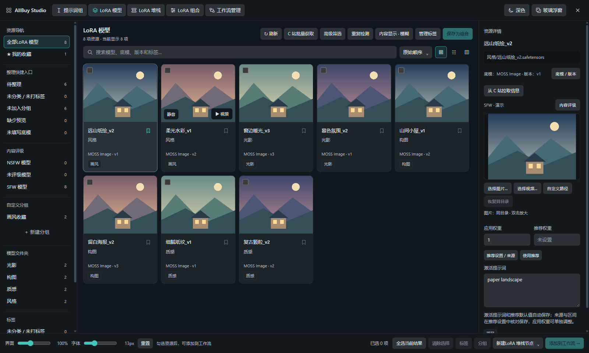

</div>

| 提示词与构图 | 模型与出图 | 素材与工作流 |
|:---:|:---:|:---:|
| 卡片合并、随机抽卡、MOSS 可视化布局 | 多 LoRA 堆叠、分组对照、采样与重绘 | 图音视频入库、图像处理、工作流整理 |

<a id="install"></a>

## 安装与上手

1. 在 **ComfyUI-Manager** 中搜索 **AllBuy** 安装；或在插件目录执行：

   ```bash
   cd ComfyUI/custom_nodes
   git clone https://github.com/3ALLBUY14/ComfyUI-AllBuy-Studio.git
   ```

2. 重启 ComfyUI，浏览器按 **Ctrl + F5** 刷新。
3. 双击画布搜索节点中文名，或打开右下角「**资源管理**」。

第一次使用，直接拖入 [示例工作流](examples/) 即可对照操作。更新可使用 Manager 的 Update 或 `git pull`，随后重启并刷新。

<a id="nodes"></a>

## 节点功能

| 提示词与布局 | 模型与生成 | 图像与素材 |
|---|---|---|
| **提示词库**：勾选卡片，合并正负提示词 | **LoRA 堆栈**：底模与多 LoRA 一起加载 | **素材加载**：图片、音频、视频统一管理 |
| **随机抽卡**：按分类标签抽取，锁定必含卡 | **生成**：文生图、图生图、重绘与扩图 | **批量选图**：为图片批量关联提示词 |
| **文本框**：长文本、替换表、一键入库 | **A/B 对比**：拖动分割线对比，批次翻页 | **图层合成器**：叠图、变换、混合与抠图 |
| **布局提示词（MOSS）**：排布文字、物体与角色 | **多图拼接**：横向、纵向、网格排列 | **图片标题**：逐图添加标题与文字样式 |

### 提示词：存卡片，随用随选

勾选即合并；支持分类、标签、收藏、搜索与导入导出。随机抽卡可按种子复现，文本框可批量替换。悬停卡片查看封面、备注与原始提示词，长内容可滚动和复制。

| 提示词库 | 随机抽卡 | 文本框 |
|:---:|:---:|:---:|
| 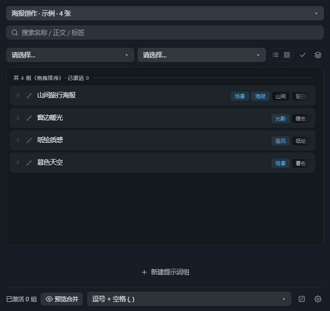 | 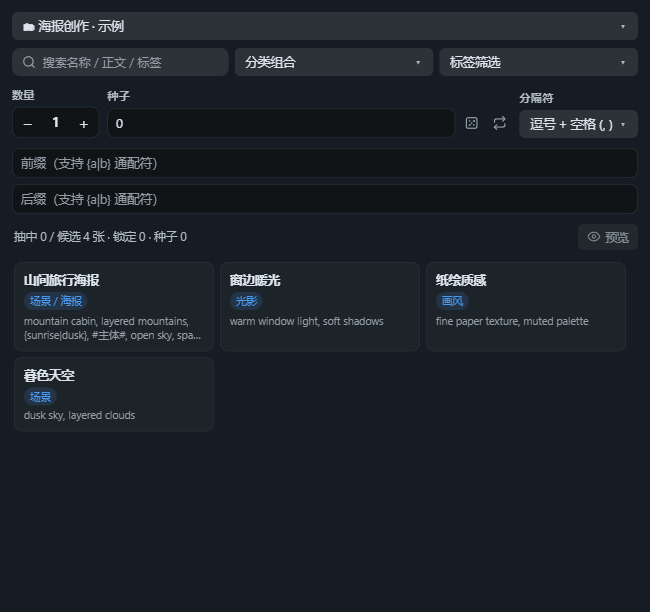 | 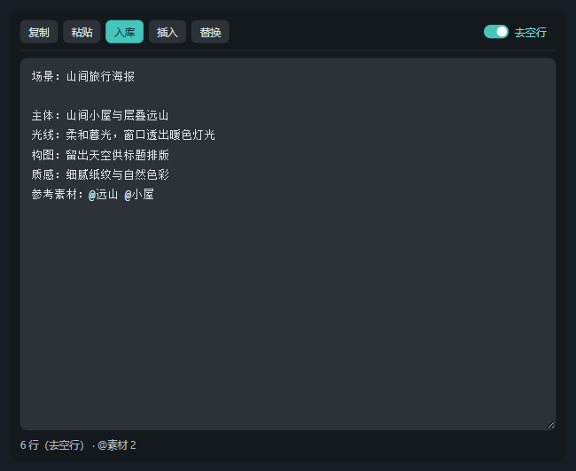 |

<details>
<summary>查看悬浮信息卡与库选择器</summary>

<p align="center">
  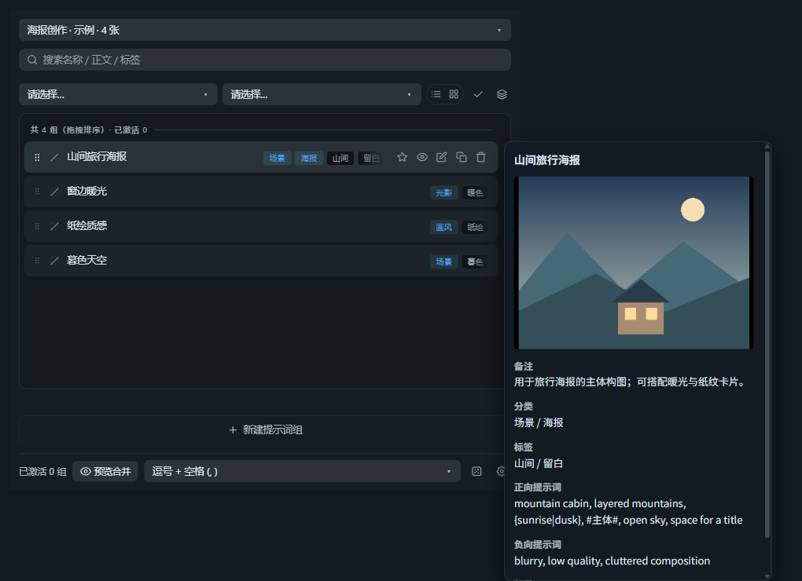<br>
  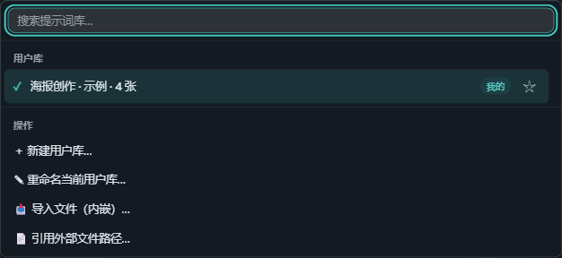
</p>

卡片支持 `{a|b}` 随机通配和命名槽变量；输出接到 CLIP 文本编码节点。

</details>

### LoRA 与生成：搭配好，一起运行

- **LoRA 堆栈**：支持 Checkpoint / UNET / GGUF，独立选择 CLIP 与 VAE；调权重、填激活词，常用搭配存成列表。
- **分组与对照**：多选分组、折叠、整组启停；暂时停用整栈后可恢复原组合。
- **文件找回**：检查移动或缺失的模型，选择「缺失时停止」或「缺失时跳过」。
- **生成**：不接底图是文生图；接底图是图生图，接遮罩可局部重绘，也可打开画布扩图。

| LoRA 堆栈 | 生成 |
|:---:|:---:|
| 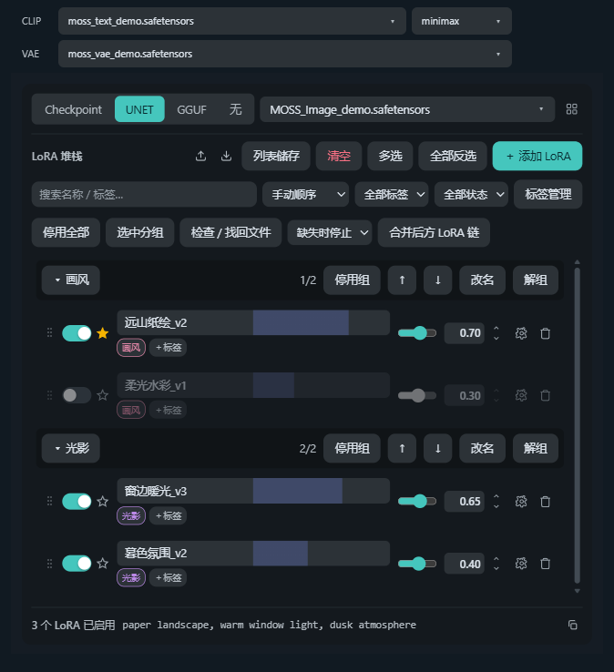 | 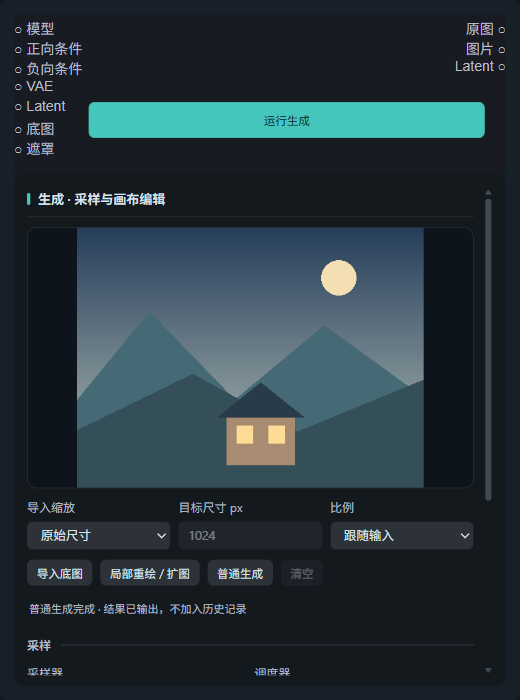 |

<details>
<summary>更多选择与调参功能</summary>

- 添加弹窗支持搜索、标签筛选与跨搜索勾选，一次加入多个模型。
- 悬停模型名查看预览与来源信息；Shift + 微调按钮使用 0.01 步进。
- 底模可选「无」，单独使用 CLIP / VAE 与激活词；GGUF 需安装 [ComfyUI-GGUF](https://github.com/city96/ComfyUI-GGUF)。
- 可将下游原生 `LoraLoaderModelOnly` 串联加载链合入堆栈。

<p align="center">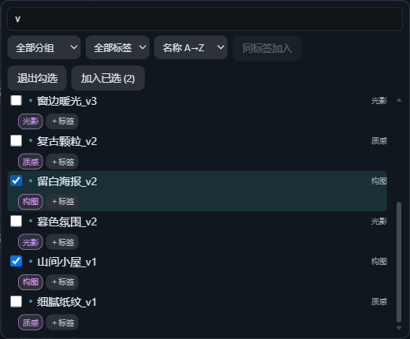</p>

</details>

### MOSS：把构图直接排出来

打开布局工作台，拖动方框排布文字、物体和角色，输出 **提示词、宽度、高度与布局草稿**。支持撤销重做、参考底图和 JSON 导入导出。

**分辨率联动**：选择像素档位与比例自动计算宽高，并显示实际 MP；外部宽高输入优先，布局框随尺寸按比例调整。深浅画布都有定位网格，节点高度随预览自适应。

| 深色工作台 | 浅色工作台 |
|:---:|:---:|
| 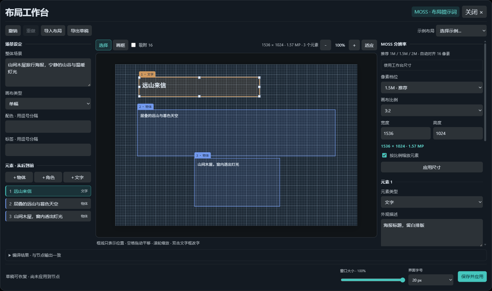 | 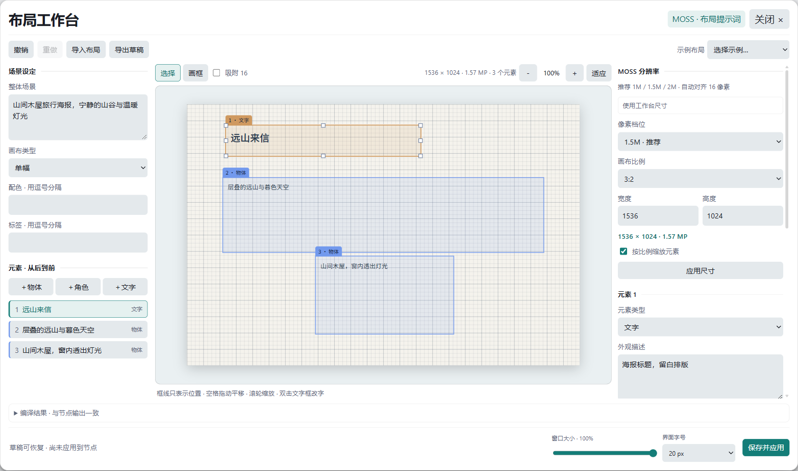 |

提示词接已有 MOSS-Image 工作流的文本编码输入，宽高接 Latent。参考底图仅用于构图对照。详见 [布局工作台指南](docs/moss-layout.md)与[示例 11](examples/11_MOSS布局提示词.json)。

### 素材与后期：导入、编辑、组合

素材加载支持拖入或粘贴文件，图片按选择顺序输出；图片可裁剪和绘制遮罩，视频可选段抽帧，音频可裁剪选区。批量选图可为每张图片关联提示词组。

| 批量选图 | 素材加载 |
|:---:|:---:|
| 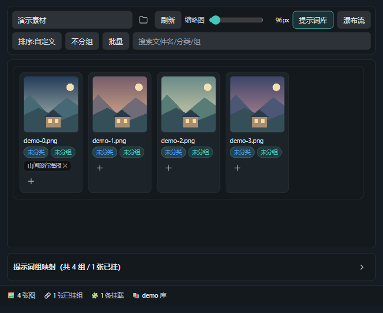 | 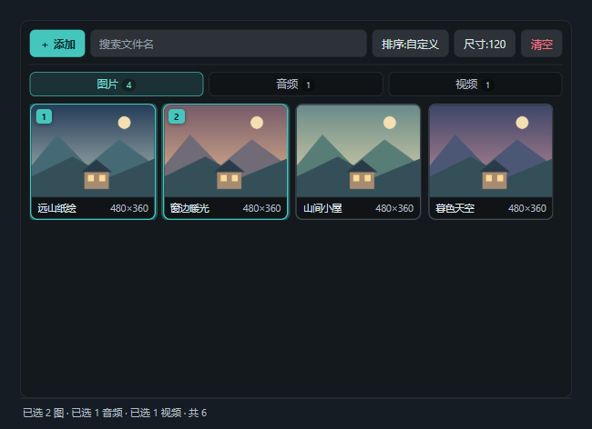 |

<details>
<summary>查看图片、视频与音频编辑器</summary>

| 图片：裁剪与遮罩 | 视频：选段与抽帧 | 音频：波形裁剪 |
|:---:|:---:|:---:|
| 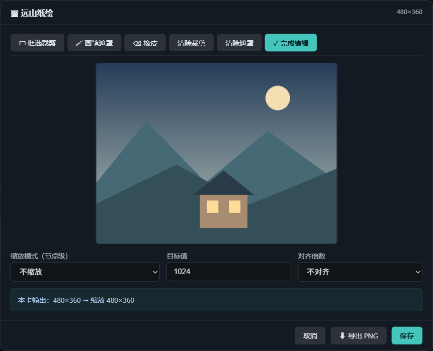 | 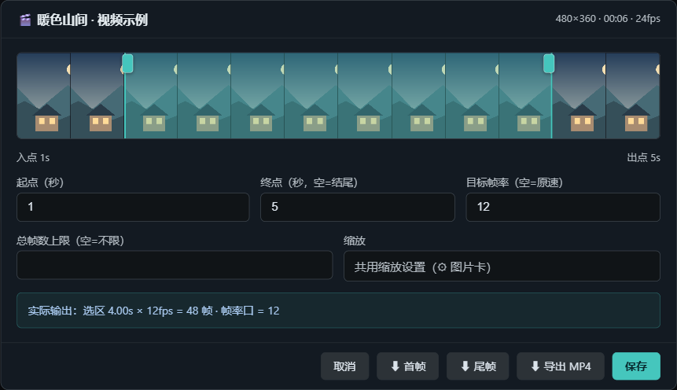 | 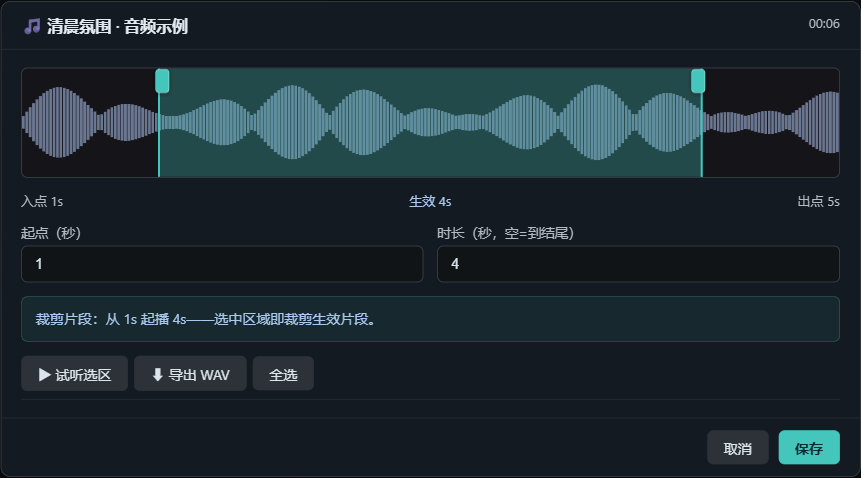 |

</details>

图层合成器可自由叠图、混合、描边与抠图；多图拼接支持最多 12 路输入，图片标题可批量加字。A/B 对比支持分割线与批次翻页。详见 [图像工具指南](docs/image-tools.md)。

<details>
<summary>查看图像处理节点</summary>

<p align="center">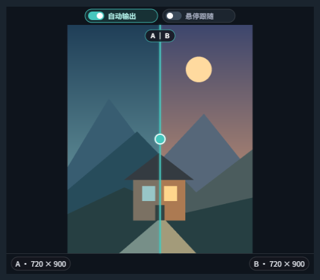</p>

| 图层合成器 | 多图拼接 | 图片标题 |
|:---:|:---:|:---:|
| 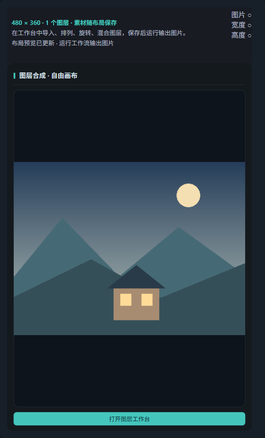 | 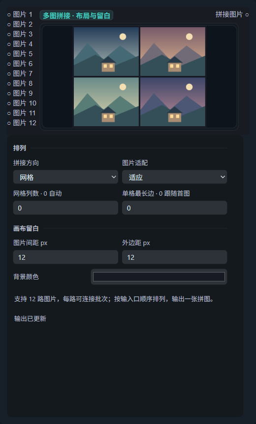 | 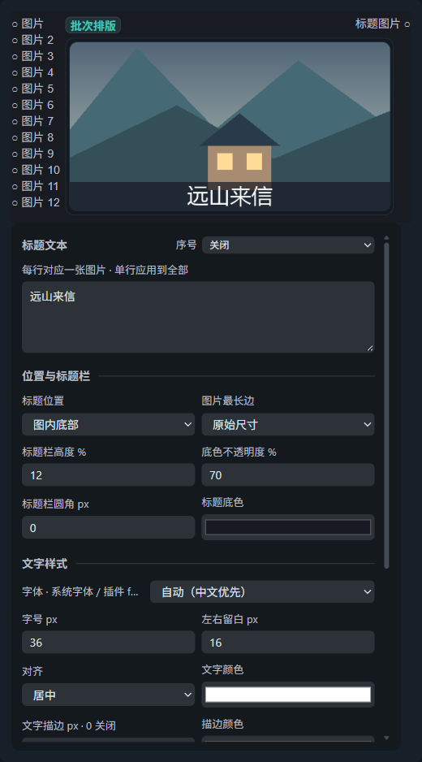 |

</details>

<a id="manager"></a>

## 全屏资源管理

打开右下角「资源管理」，在五个页签中整理资源，勾选后点「**添加到工作流**」。

| 页签 | 主要功能 |
|---|---|
| **提示词组** | 切换库，按分类、标签、收藏浏览，批量整理与导入导出 |
| **LoRA 模型** | 分组与标签、图片视频预览、Civitai 来源信息、高级筛选与重复检测 |
| **LoRA 堆栈** | 先编辑草稿，再应用到工作流节点 |
| **LoRA 组合** | 保存、复用与分享常用搭配 |
| **工作流管理** | 文件夹、标签、收藏、封面与回收站，双击打开工作流 |

面板支持深浅主题、字号和界面缩放。Civitai 信息按需导入，分类标签由你自己管理。授权、代理、内容显示、查重和工作流整理见 [资源管理指南](docs/resource-manager.md)。

<details>
<summary>查看资源管理界面</summary>

<p align="center">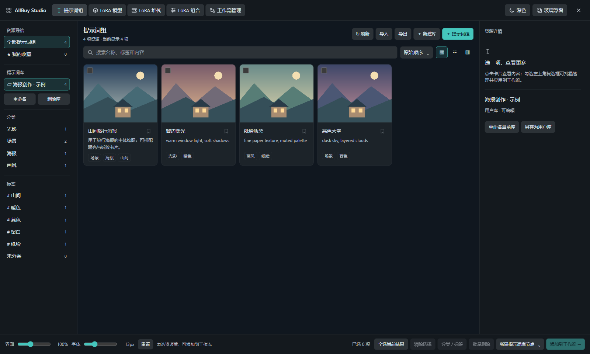</p>

| 堆栈编辑 | 组合管理 |
|:---:|:---:|
| 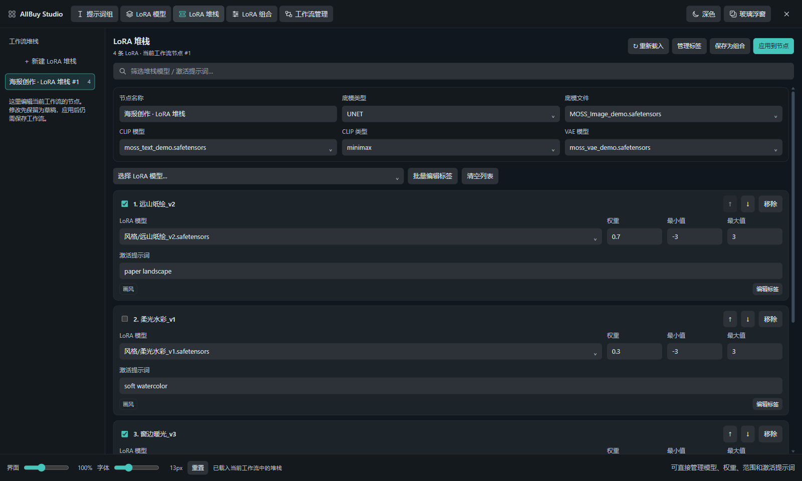 | 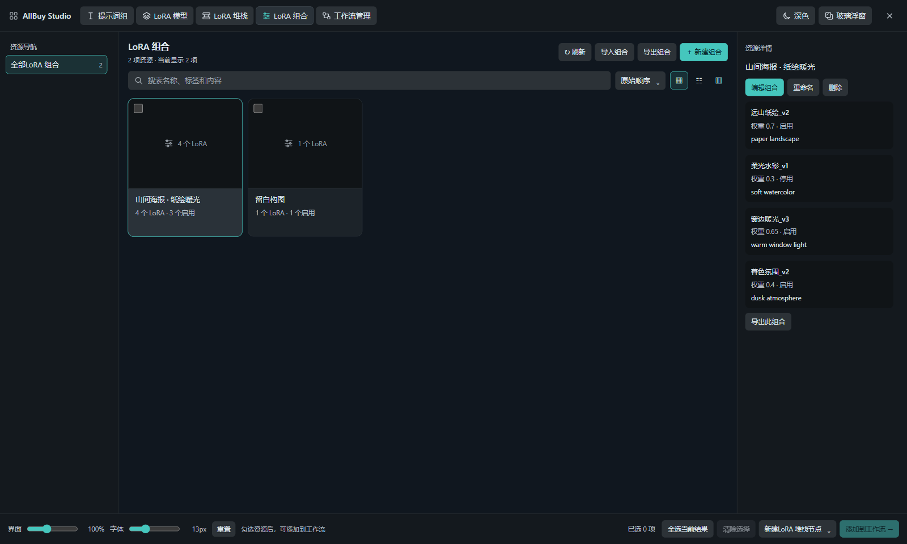 |

| 右键快捷菜单 | 标签管理 |
|:---:|:---:|
| 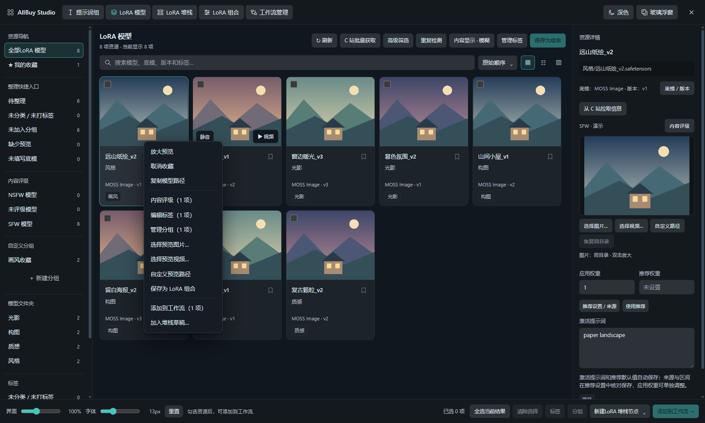 | 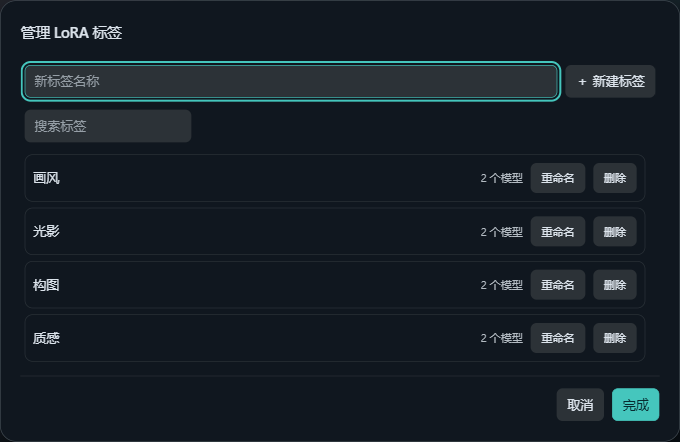 |

| 图片预览 | 视频预览 |
|:---:|:---:|
| 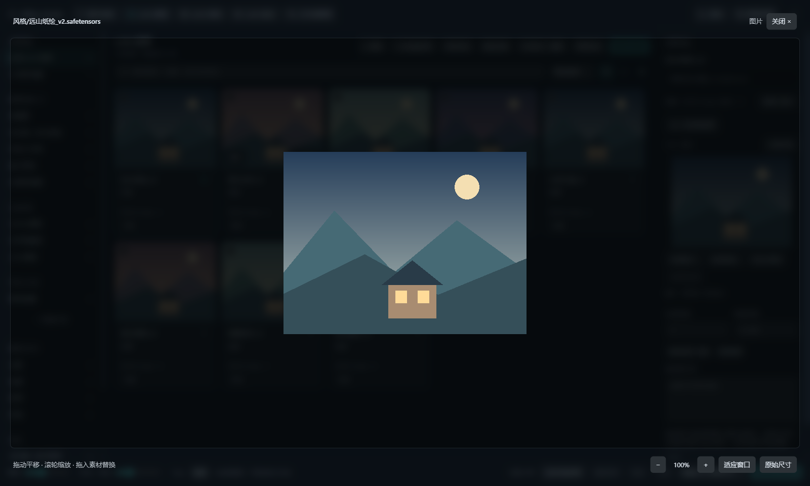 | 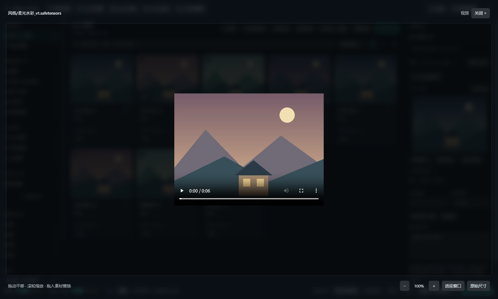 |

</details>

<a id="backup"></a>

## 备份与常见问题

迁移或重装 ComfyUI 时，请保留这些目录：

| 数据 | 目录 |
|---|---|
| 提示词库、LoRA 组合与标签 | `ComfyUI/user/allbuy_promptlibrary/` |
| 导入的图音视频素材 | `ComfyUI/input/allbuy_media/` |
| 工作流与回收站 | ComfyUI 用户目录下的 `workflows/` 与 `allbuy/workflow-trash/` |

<details>
<summary>更新、兼容与预览问题</summary>

- **更新后界面没变化？** 重启 ComfyUI，再按 Ctrl + F5。
- **旧版更新提示历史冲突？** 先备份本地修改，再重新安装插件；保留上表中的用户数据目录。
- **旧工作流还能用吗？** 节点名称与数据位置保持兼容，可直接打开。旧版提示词库插件与本插件只保留一份。
- **改完面板后出图没变？** 应用到节点、保存工作流，再运行。
- **视频不能预览？** 建议使用 MP4（H.264）或 WebM。

</details>

---

<div align="center">

[示例工作流](examples/) · [MOSS 布局](docs/moss-layout.md) · [图像工具](docs/image-tools.md) · [资源管理](docs/resource-manager.md) · [参与开发](CONTRIBUTING.md)

MIT License · 喜欢这套工具，欢迎点个 ⭐

</div>
