<div align="center">

# AllBuy Studio｜AllBuy 创作套件

**集提示词、LoRA、素材与工作流管理于一体的中文 ComfyUI 创作套件**


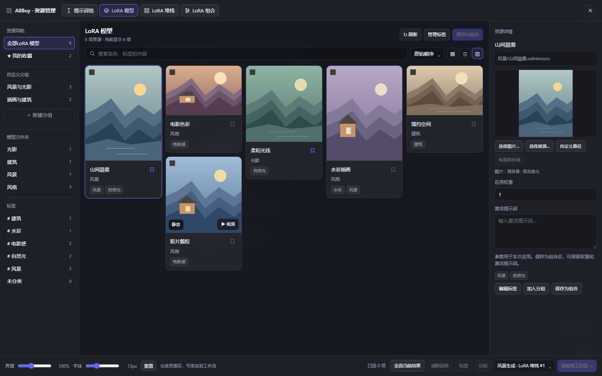

</div>

> [!NOTE]
> 本文附图均为插件实际界面截图，使用虚构的示例库、模型名与提示词，不包含真实用户数据。

<div align="center">

<sub>🔍 中文搜索节点 · 🔒 执行锁定 · 🌓 旁路变暗 · 🗑 工作流回收站 · 🏞 瀑布流预览 · 🌗 明暗主题</sub>

</div>

## ✨ 它能帮你做什么

| | |
|---|---|
| 🗂 **管理提示词** | 大段提示词拆成卡片，勾选即合并；随机抽卡批量找灵感 |
| 🧩 **管理 LoRA** | 一个节点叠完全部 LoRA；全屏面板管分组、标签与常用组合 |
| 🖼 **管理素材** | 图片 / 音频 / 视频拖进即存；裁剪、抽帧、裁音频都在面板里完成 |
| 🔀 **管理工作流** | 文件夹、标签、收藏、回收站，全屏浏览自己的全部工作流 |

## 📦 安装

1. **ComfyUI-Manager**：打开 Custom Nodes Manager 搜索 **AllBuy** 安装；或克隆到插件目录：

```bash
cd ComfyUI/custom_nodes
git clone https://github.com/3ALLBUY14/ComfyUI-AllBuy-Studio.git
```

2. 重启 ComfyUI，浏览器按 **Ctrl + F5** 强制刷新
3. 右下角出现「资源管理」小浮窗即安装成功

> [!TIP]
> **更新**：Manager 里点 Update，或 `git pull`；更新后同样需要重启 ComfyUI + Ctrl + F5。

> [!NOTE]
> 旧版 `ComfyUI-AllBuy_PromptLibrary` 用户：直接安装新版即可，旧工作流、提示词库与 LoRA 数据全部自动兼容，无需迁移；新旧两份插件只保留一份。

## 🚀 三步上手

| ① 加节点 | ② 玩示例 | ③ 管素材 |
|:---:|:---:|:---:|
| 双击画布，搜节点中文名添加（如「提示词库」「LoRA 堆栈」） | 把 `examples/` 的示例拖进画布照着玩（10 个，带使用说明） | 点右下角浮窗打开**全屏资源管理面板** |

<details>
<summary>📁 示例工作流清单（点击文件名查看，拖进画布即用）</summary>

| 示例 | 演示内容 |
|---|---|
| [01 提示词库](examples/01_提示词库.json) | 最小可用：建卡 → 勾选 → 合并输出 |
| [02 随机抽卡找灵感](examples/02_随机抽卡找灵感.json) | 调数量与种子，锁定必含卡 |
| [03 批量选图映射](examples/03_批量选图映射.json) | 图片批量挂提示词组 |
| [04 素材加载](examples/04_素材加载.json) | 图 / 音 / 视频入库与选区 |
| [05 图像对比](examples/05_图像对比.json) | 分割线对比与翻页 |
| [06 LoRA 加载器](examples/06_LORA加载器.json) | 底模 + LoRA 出图全链路 |
| [07 文本框](examples/07_文本框.json) | 大段文本与替换表 |
| [08 多图拼接](examples/08_多图拼接.json) | 四图网格拼接 |
| [09 图片标题](examples/09_图片标题.json) | 逐图加标题栏 |
| [10 图层工具台](examples/10_图层工具台.json) | 图层合成 + 尺寸联动 |

</details>

## 🧩 节点一览

| 提示词 | 图像素材 | 模型与出图 |
|---|---|---|
| 📚 [提示词库](#提示词库存卡片勾选即生效)：存卡片勾选合并 | 🖼 [素材加载](#素材加载图音视频一起管)：图 / 音 / 视频素材库 | 🧩 [LoRA 堆栈](#lora-堆栈一个节点装完模型)：底模 + 多 LoRA |
| 🎲 [随机抽卡](#随机抽卡批量找灵感)：随机抽 N 张，种子可复现 | 🗂 [批量选图](#批量选图给图片挂提示词)：图片批量挂提示词组 | 🎨 [生成](#生成采样重绘一个节点)：采样 / 图生图 / 重绘 / 扩图 |
| 📝 [文本框](#文本框大段文本编辑)：大段文本 + 替换表 | | 🔀 [A/B 对比](#ab-图像对比) · 🧵 [图层合成](#图层合成--多图拼接--图片标题) · 🖼 多图拼接 · 🏷 图片标题 |

---

## ✍️ 写提示词

### 提示词库——存卡片，勾选即生效

1. 点「＋ 新建提示词组」，把大段提示词贴进正向 / 负向框，选分类和标签
2. 勾选卡片即生效：多组按顺序自动合并，正负提示词分别输出
3. 输出接到 CLIP 文本编码节点即可出图

卡片支持 `{a|b}` 随机通配与命名槽变量；库可搜索、收藏、导入导出。

<p align="center">
  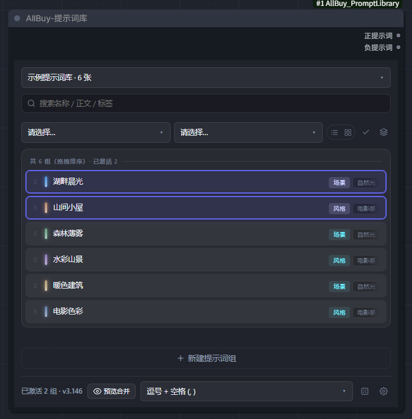<br>
  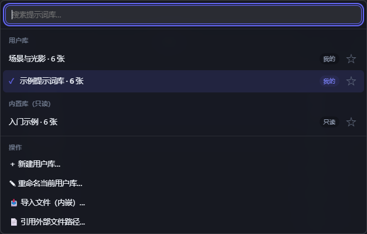
</p>

### 随机抽卡——批量找灵感

选库、调数量、点 🎲 换种子；卡片可「锁定」为必含。相同种子结果可复现，适合批量尝试不同搭配。

### 文本框——大段文本编辑

贴整段提示词，用替换表每行一条 `旧词=新词` 批量替换；支持去空行、撤销重做，内容可一键转入提示词库变成卡片。

| 随机抽卡节点 | 文本框节点 |
|:---:|:---:|
| 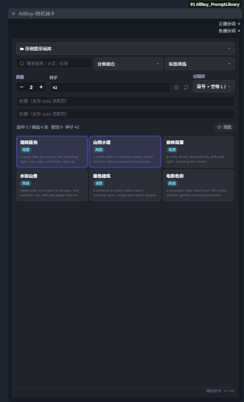 | 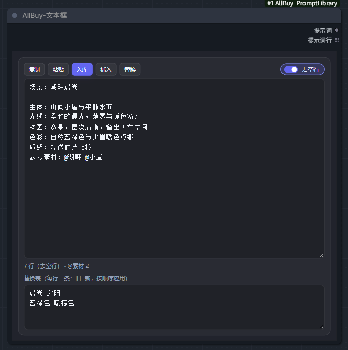 |

---

## 🖼 图与素材

### 批量选图——给图片挂提示词

从 ComfyUI input 目录取图，给每张图挂一个提示词组；一次输出整批图片 + 逐图合并的提示词。适合 LoRA 训练集整理和成套出图，映射关系可导出保存。

### 素材加载——图、音、视频一起管

1. 拖文件进面板（或 Ctrl + V 粘贴）即入库，重启不丢
2. 图片可多选按顺序排成 batch；点 ⚙ 打开编辑器
3. 图片：框选裁剪 + 画笔遮罩；视频：选段抽帧；音频：波形裁剪

| 批量选图节点 | 素材加载节点 |
|:---:|:---:|
| 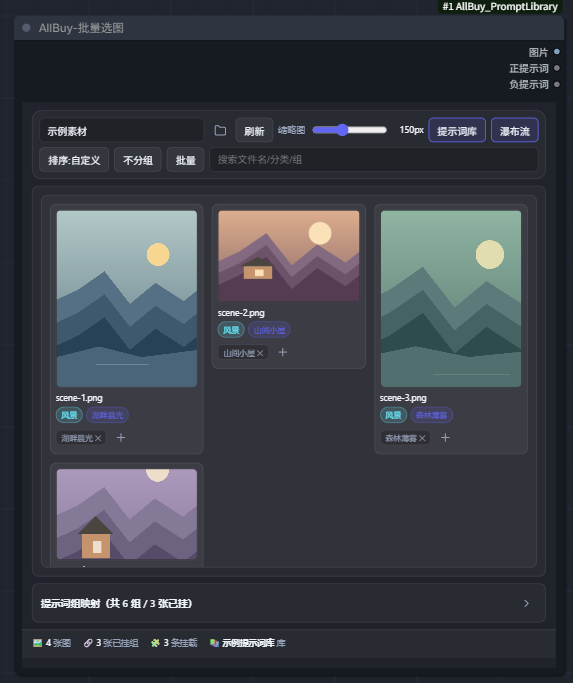 | 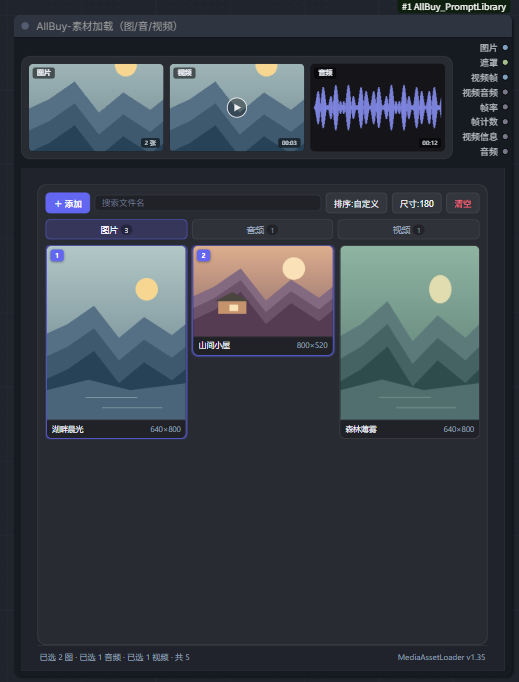 |

| 图片：裁剪 + 遮罩 | 视频：选段抽帧 | 音频：波形裁剪 |
|:---:|:---:|:---:|
| 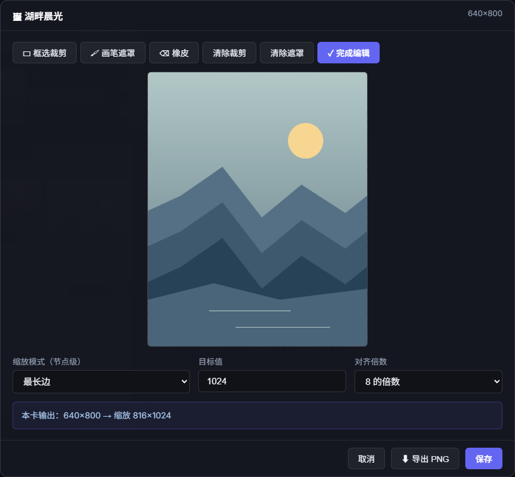 | 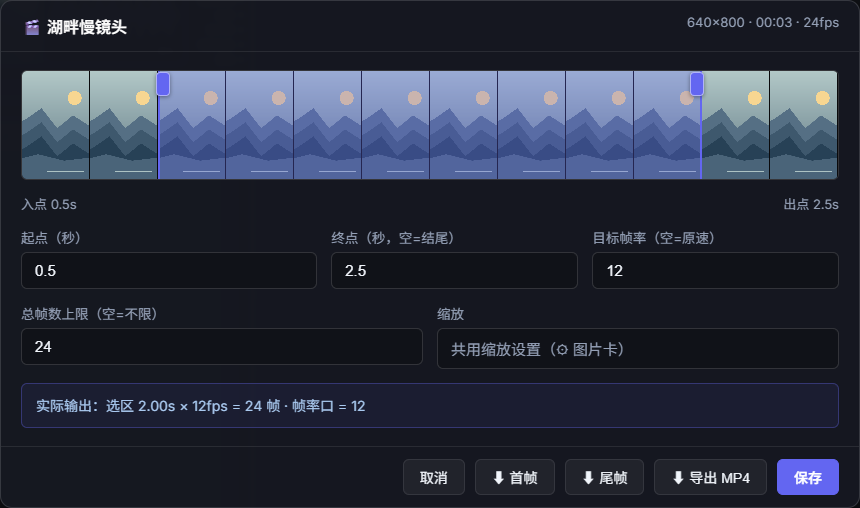 | 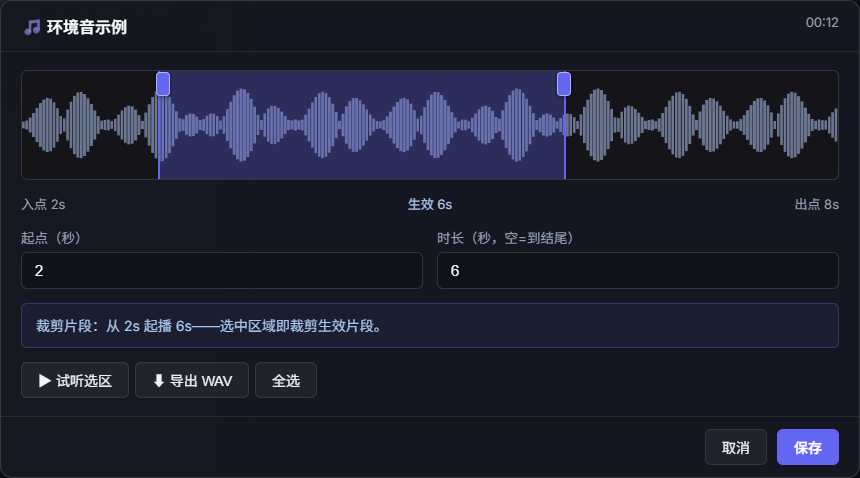 |

---

## 🎨 模型与出图

### LoRA 堆栈——一个节点装完模型

1. 选底模类型（Checkpoint / UNET / GGUF）和模型文件
2. 「添加 LoRA」：每行可调权重、填触发词、开关启停、拖拽排序
3. 模型 / CLIP / VAE 三个口接下游；常用搭配存成「列表」随时复用

> [!TIP]
> GGUF 量化模型需另装 [ComfyUI-GGUF](https://github.com/city96/ComfyUI-GGUF) 插件；底栏实时汇总全部触发词，一键复制。

<p align="center">
  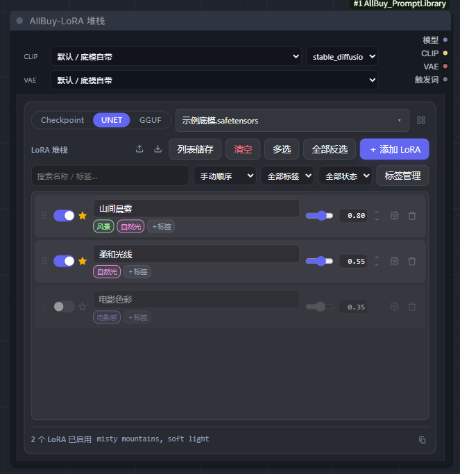
</p>

### 生成——采样重绘一个节点

文生图、图生图、遮罩重绘、扩图都在这一个节点完成：不接图是文生图；接「底图」即图生图；再接「遮罩」只重绘遮罩区域。

<p align="center">
  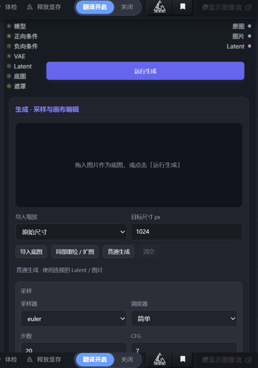
</p>

### A/B 图像对比

拖分割线对比两张图；批量输入按页翻看；选中侧直接输出，可当选择开关用。

<p align="center">
  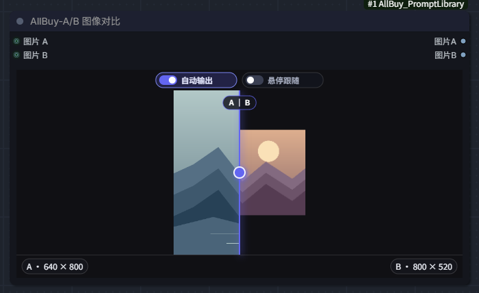
</p>

### 图层合成 · 多图拼接 · 图片标题

| 节点 | 用途 |
|---|---|
| **图层合成器** | 自由画布叠图层：拖动、缩放、混合、描边、橡皮、自动抠图 |
| **多图拼接** | 最多 12 路图片拼成一张：横向 / 纵向 / 网格 |
| **图片标题** | 逐张加标题栏：字体、描边、阴影、圆角都可调 |

| 图层合成器 | 多图拼接 | 图片标题 |
|:---:|:---:|:---:|
| 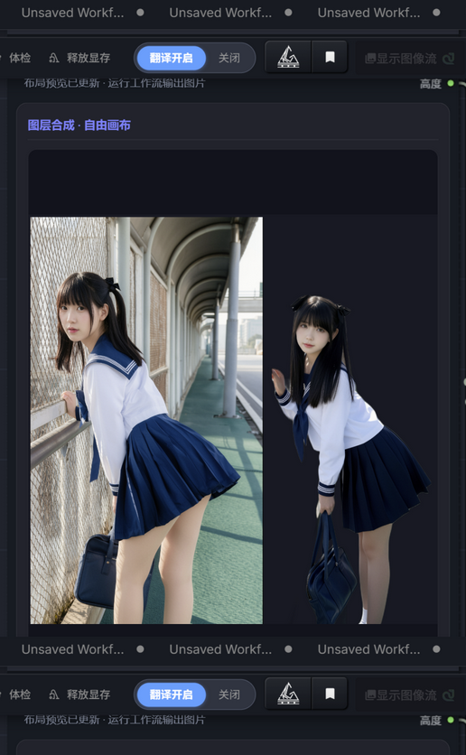 | 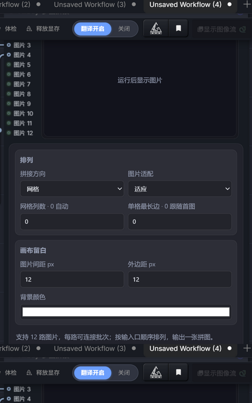 | 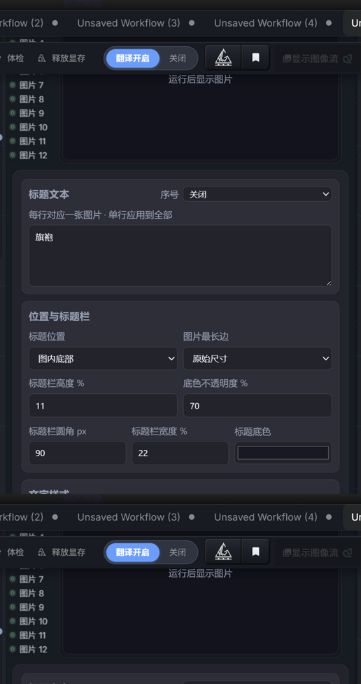 |

详细用法见[图像工具说明](docs/image-tools.md)。

---

## 🗂 全屏资源管理面板

点右下角浮窗打开，五个页签管全部资源；勾选资源后点「**添加到工作流**」即可应用到当前画布。

| 页签 | 管什么 |
|---|---|
| **提示词组** | 切换库、搜索、按分类 / 标签 / 收藏筛选，批量整理与导入导出 |
| **LoRA 模型** | 读真实模型列表，按文件夹 / 分组 / 标签浏览；支持图片视频预览与瀑布流 |
| **LoRA 堆栈** | 在工作流外预先编辑堆栈，再一键应用到节点 |
| **LoRA 组合** | 保存常用 LoRA 搭配（含权重与顺序），可分享导入导出 |
| **工作流管理** | 文件夹树、标签、收藏、封面预览、回收站；双击直接打开 |

<p align="center">
  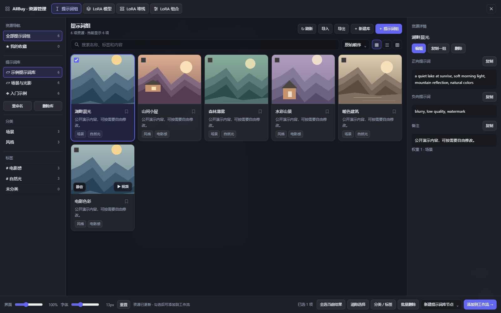
</p>

<details>
<summary>📂 展开查看：面板其余功能截图</summary>

| LoRA 堆栈编辑 | LoRA 组合管理 |
|:---:|:---:|
| 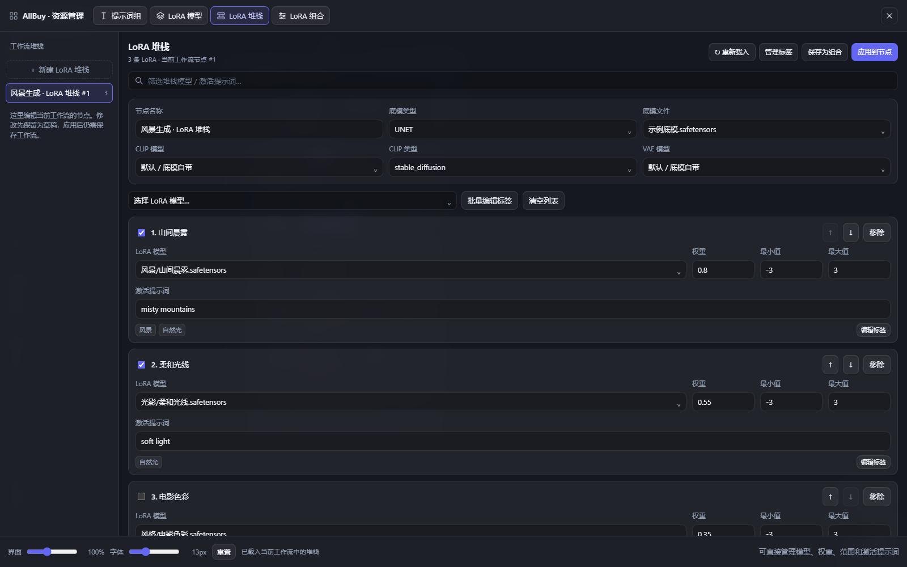 | 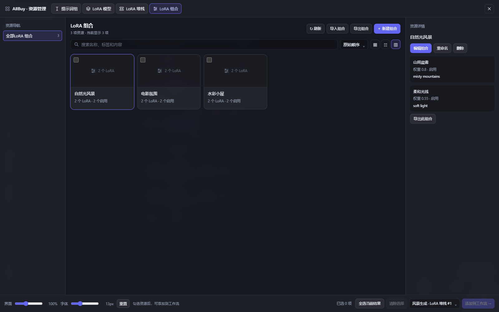 |

| 卡片右键快捷菜单 | 标签管理 |
|:---:|:---:|
| 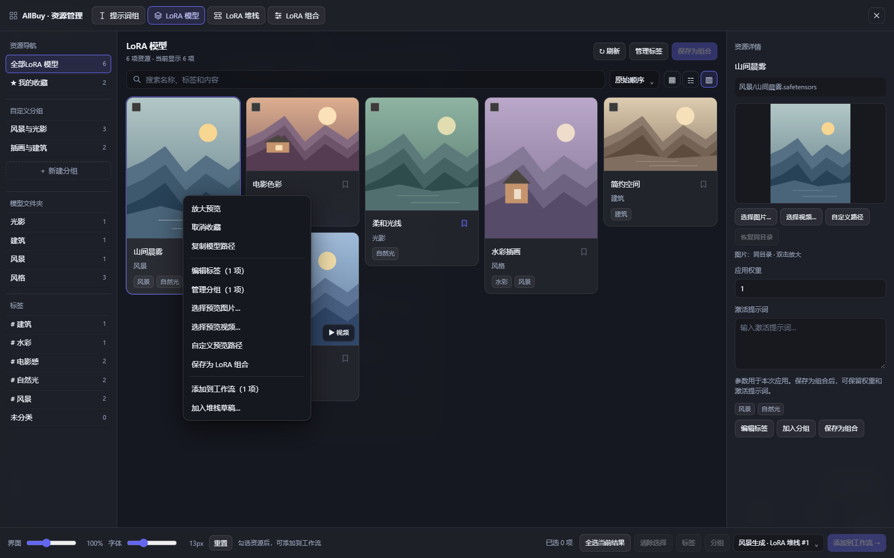 | 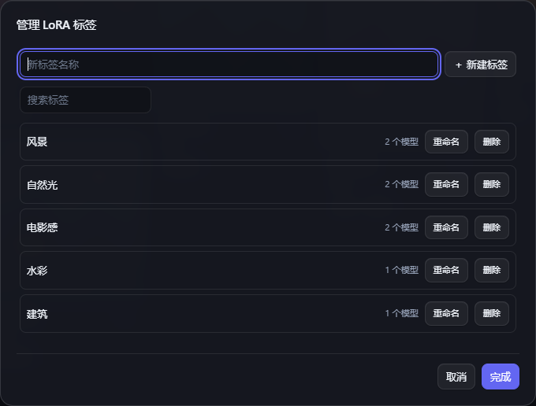 |

| 图片放大预览 | 视频放大预览 |
|:---:|:---:|
| 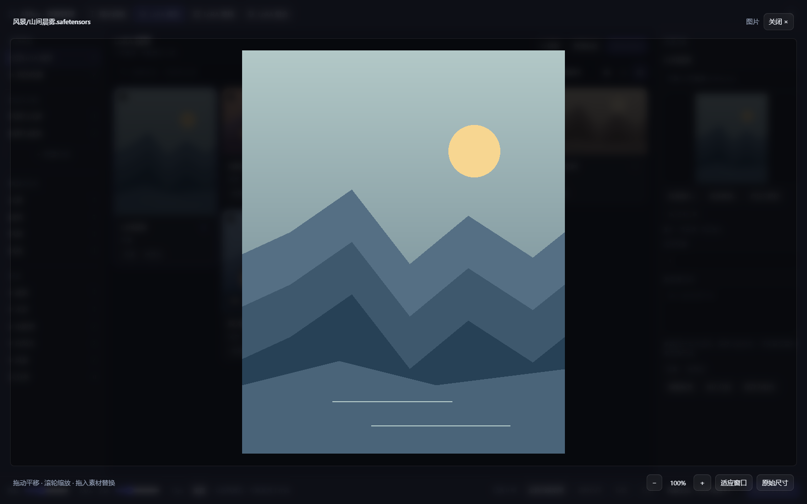 | 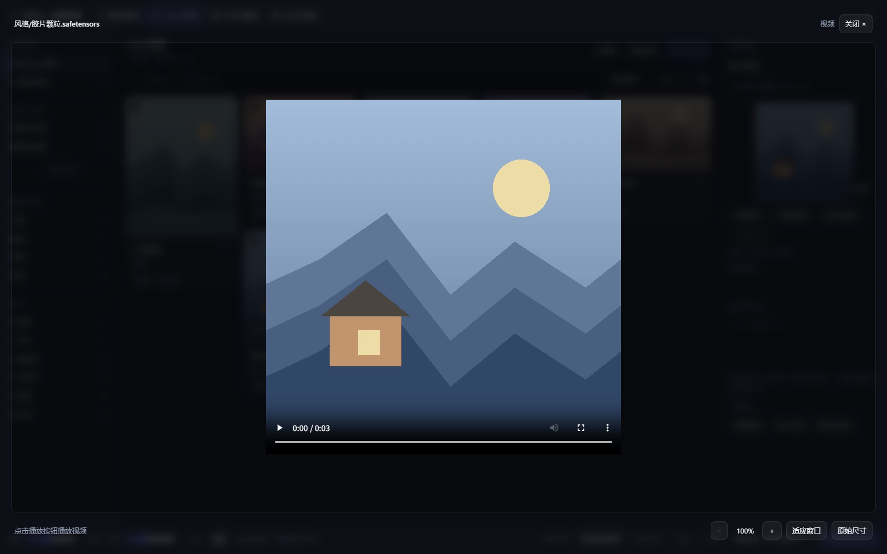 |

</details>

> [!TIP]
> 右上角可切换亮色 / 深色主题；**Esc** 收起面板，浮窗可拖动；节点 Ctrl+M 旁路时面板同步变暗。

---

## 💾 我的数据存在哪（备份必读）

> [!IMPORTANT]
> 备份或迁移 ComfyUI 时，请连同下表目录一起复制，否则提示词库与素材会丢失。

| 内容 | 位置 |
|---|---|
| 提示词库、LoRA 组合 / 标签 | `ComfyUI/user/allbuy_promptlibrary/` |
| 导入的图片 / 音频 / 视频 | `ComfyUI/input/allbuy_media/` |
| 工作流（ComfyUI 自带目录） | ComfyUI 用户目录 `workflows/` |
| 面板里的工作流回收站 | 用户目录 `allbuy/workflow-trash/` |

## ❓ 常见问题

❔ **更新后界面没变化？**
重启 ComfyUI，浏览器按 Ctrl + F5 强制刷新。

❔ **面板里改了提示词，出图没变？**
面板改动只写入节点，还需在 ComfyUI 里保存工作流再运行。

❔ **旧版本的工作流还能用吗？**
能。节点名称与数据目录保持兼容，老工作流直接打开即可。

❔ **LoRA 预览视频放不出来？**
与浏览器支持的编码有关，建议使用 MP4（H.264）或 WebM。

---

<div align="center">

<sub>示例工作流见 [`examples/`](examples/) · 图像工具详细说明见 [`docs/image-tools.md`](docs/image-tools.md) · MIT License</sub>

如果这套件帮到了你，欢迎点个 ⭐ Star 让更多人看到

</div>
